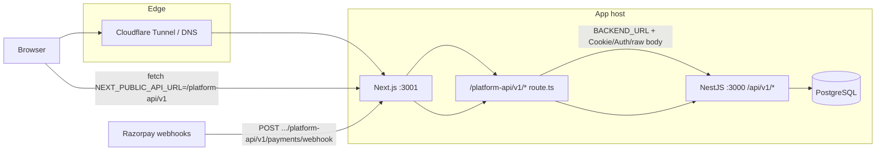

# Garud Monorepo — Architecture Connectivity Audit

**Date:** 2026-11-05  
**Scope:** Frontend ↔ backend wiring, auth session path, Nest module registration, deploy/CI env alignment, snapshot bridges vs React routes, and broken API links.  
**Method:** Static review of `next.config.ts`, `middleware.ts`, `frontend/app/platform-api/v1/[...path]/route.ts`, `frontend/lib/api/*`, backend controllers/modules, deploy examples, and CI workflows. No long-running integration tests were executed.

---

## Request flow (production-shaped)

Browser traffic is intended to hit **Next.js on `:3001`** (Cloudflare Tunnel / PM2). Platform API calls use a **same-origin proxy** so httpOnly auth cookies work without CORS.

**Path mapping:** `/platform-api/v1/{path}` → `{BACKEND_URL}/api/v1/{path}` (see `frontend/app/platform-api/v1/[...path]/route.ts`).

**Legacy marketing:** Snapshot HTML may still reference `/api/*`; `next.config.ts` rewrites `/api/:path*` → `https://garudhub.com/api/:path*` (legacy upstream, not Nest).

---

## Connected ✅

| Area | Frontend surface | Backend route prefix / module | Status |
|------|------------------|----------------------------------|--------|
| **API base** | `getApiBase()` → `NEXT_PUBLIC_API_URL` default `/platform-api/v1` (`frontend/lib/api/client.ts`) | Global prefix `api/v1` (`backend/src/main.ts`) | ✅ Aligned via proxy |
| **Proxy → Nest** | `platform-api/v1/[...path]/route.ts` | Forwards Cookie, Authorization, `x-request-id`, client IP, Razorpay raw body + headers | ✅ |
| **Auth** | `authApi`, `AuthProvider`, `usesCookieSession()` (`lib/api/auth-storage.ts`) | `auth/*`, JWT from cookie or bearer (`jwt.strategy.ts`, `auth-session.helper.ts`) | ✅ Cookie-first; break-glass documented |
| **Marketplace** | `lib/api/marketplace.ts`, marketplace pages | `marketplace/*` (`MarketplaceController`) | ✅ |
| **Cart / checkout** | `lib/api/cart.ts`, buyer checkout page | `buyer/cart`, `buyer/checkout` (`CommerceModule`) | ✅ |
| **Orders** | Buyer/partner/admin order pages, `payments.ts` | `buyer/orders`, `partner/orders`, `admin/orders`, `payments/*` | ✅ |
| **Payments / webhooks** | Checkout Razorpay + bank transfer | `POST payments/webhook` (raw body in `main.ts`); proxy forwards signature headers | ✅ Documented staging/prod URLs |
| **RFQ** | Buyer/partner RFQ pages | `rfq`, `partner/rfqs` (`RfqModule`) | ✅ |
| **Partner onboarding** | Partner application, documents | `partner/me`, `partner/application`, `partner/documents` | ✅ |
| **Partner catalog** | Partner catalog CRUD, listing media | `partner/catalog/listings`, `media/listings` | ✅ |
| **Partner hub / billing** | Partner dashboard, subscription | `partner/overview`, `partner/subscription`, `admin/billing` | ✅ |
| **Admin ops** | `lib/api/admin.ts`, admin UI | `admin/overview`, `audit-log`, `users`, `leads`, `analytics` | ✅ |
| **Admin catalog / apps** | Listings & applications review | `admin/listings`, `admin/applications` | ✅ |
| **Enquiries** | `/enquiry`, `lib/api/enquiries.ts` | `POST enquiries`, `admin/enquiries`, `partner/leads` | ✅ PHP path retired → React |
| **Service requests** | `lib/api/service-requests.ts`, services UI | `POST service-requests` (intake), `service-requests/track/*`, buyer/partner/admin controllers | ✅ Intake + tracking wired |
| **Training** | Training API + partner institute UI | `training/courses`, `partner/training` | ⚠️ See gaps (PUT via proxy) |
| **Gov opportunities** | `lib/api/gov.ts`, gov admin/buyer flows | `gov/opportunities`, `buyer/gov-opportunities`, `admin/gov-opportunities` | ✅ |
| **Partnerships** | `lib/api/partnerships.ts` | `partner/partnerships`, `admin/partnerships` | ✅ |
| **Messages** | `lib/api/messages.ts` | `buyer/conversations`, `partner/conversations` | ✅ |
| **Notifications** | `lib/api/notifications.ts` | `notifications/*` | ✅ |
| **Health** | (ops / smoke) | `GET /api/v1/health` (`AppController`) | ✅ |
| **CRM webhooks (outbound)** | N/A (server-side) | `CrmWebhookService` when `CRM_WEBHOOK_URL` + `CRM_WEBHOOK_SECRET` set; validated in `env.validation.ts` | ✅ Optional integration |
| **Deploy topology** | PM2 `garudhub-web` `:3001`, `BACKEND_URL=127.0.0.1:3000` | PM2 `garudhub-api` `:3000` | ✅ Matches `deploy/pm2/ecosystem.config.example.js` + `deploy/cloudflared/config.example.yml` |
| **CI env** | `NEXT_PUBLIC_API_URL`, `BACKEND_URL` in workflows | Same as local proxy pattern | ✅ `.github/workflows/main-ci.yml`, `dev-ci.yml` |
| **Snapshot bridges** | `middleware.ts` + `lib/snapshot-bridge.ts` | Redirects legacy paths → React (`/marketplace`, `/services`, `/enquiry`, etc.) | ✅ Matcher kept in sync with bridge map |

**Backend module registration:** All feature areas above are imported in `backend/src/app.module.ts` (`Identity`, `Catalog`, `Commerce`, `Payments`, `Rfq`, `Partner`, `Admin`, `Enquiries`, `ServiceRequests`, `Training`, `Gov`, `Messages`, `PartnerHub`, `PartnerBilling`, `Partnerships`, `Documents`, `Notifications`, `Integrations`). Controllers under `backend/src/modules/**` match the frontend `apiRequest` paths reviewed (28 controller files).

**Prisma:** Services across listed modules inject `PrismaService`; domain models in `backend/prisma/schema.prisma` are exercised by those services (no orphan module without data access was found in this pass).

---

## Gaps ⚠️

| Severity | Description | Fix hint |
|----------|-------------|----------|
| **High** | **Next proxy did not export `PUT`** (fixed: `PUT` handler added in `platform-api/v1/[...path]/route.ts`). Frontend uses `PUT` for partner training profile and service-request coverage; without proxy `PUT`, browser calls returned **405**. | Verify partner training profile + coverage save via `/platform-api/v1` after deploy. |
| **Medium** | **Legacy `/api/*` rewrite** in `next.config.ts` sends traffic to `https://garudhub.com/api/*`, not Nest. Snapshot HTML rewrites some links to `/api/` (`lib/snapshot-html.ts`). Any remaining snapshot form/script that posts to `/api/` bypasses the Garud API. | Audit snapshot assets for `/api/` usage; prefer `/platform-api/v1` or React forms; remove rewrite when legacy is fully retired. |
| **Medium** | **No CORS on Nest** (`main.ts` does not call `enableCors`). Correct for same-origin proxy; **breaks** if `NEXT_PUBLIC_API_URL` is set to `http://host:3000/api/v1` for direct browser calls (documented as optional in `frontend/README.md`). | Keep prod/staging on `/platform-api/v1`; only enable CORS if a separate SPA origin is required. |
| **Low** | **GOVERNMENT role post-login redirect** uses `redirectPathForRole` → `/buyer/rfqs` (same as buyer), not a gov-specific home (`lib/platform/auth-login.ts`). Gov APIs exist under `buyer/gov-opportunities`. | Optional: redirect `GOVERNMENT` to `/services#government` or a dedicated gov dashboard route. |
| **Low** | **CI backend `NODE_ENV=test`** forces `AUTH_SESSION_MODE=bearer` on API while frontend build defaults to cookie session (`auth-cookies.ts`). CI validates compile/tests, not full cookie proxy e2e. | Accept for CI; use staging smoke (`docs/STAGING_SMOKE_GUIDE.md`) for cookie path proof. |
| **Low** | **Optional env not in validator:** e.g. `AUTH_COOKIE_SECURE` read in `auth-cookies.ts` but not listed in `env.validation.ts`. | Document in `backend/.env.example` / runbooks (partially done in `docs/AUTH_HTTPONLY.md`). |
| **Ops** | Production tunnel, Razorpay live keys, webhook registration, CRM URL — **code wired**, host execution tracked as open in `docs/NEXT_TASK_LIST.md` (e.g. NEXT-L4 prod smoke). | Follow `docs/DEPLOY_CLOUDFLARE_TUNNEL.md` and `docs/PAYMENTS_RUNBOOK.md` on the target host. |

---

## Auth connectivity (detail)

| Check | Result |
|-------|--------|
| httpOnly cookies (`garud_access`, `garud_refresh`) | Set by Nest on login/register/refresh when `AUTH_SESSION_MODE` is `cookies` (default except test) |
| Proxy forwards `Cookie` on upstream fetch | Yes |
| Proxy forwards `Set-Cookie` from upstream | Yes (`getSetCookie` loop) |
| Client sends credentials | `credentials: 'include'` when cookie session |
| JWT validation | Cookie first, then `Authorization` bearer (`jwt.strategy.ts`) |
| Role gates in UI | `RequireAuth` + `redirectPathAfterLogin` for admin/partner/buyer |

---

## Deploy & env parity

| Variable | Local example | PM2 example | CI |
|----------|---------------|-------------|-----|
| `NEXT_PUBLIC_API_URL` | `/platform-api/v1` | (set on web app) | `/platform-api/v1` |
| `BACKEND_URL` | `http://127.0.0.1:3000` | `http://127.0.0.1:3000` | `http://127.0.0.1:3000` |
| Web port | dev default | **3001** | n/a |
| API port | **3000** | **3000** | test DB + Nest tests |
| Tunnel | — | **→ 127.0.0.1:3001** (app hostname) | — |

Razorpay webhook (recommended): `https://<app-host>/platform-api/v1/payments/webhook` (proxied) or direct `https://api.<host>/api/v1/payments/webhook` (second tunnel ingress).

---

## Overall verdict

**Production-ready wiring estimate: ~88%**

Core B2B flows (auth via proxy, marketplace, cart, checkout, payments, RFQ, partner, admin, enquiries, service requests, training reads, gov, messages, notifications) are **architecturally connected** with consistent `/platform-api/v1` → `/api/v1` mapping and modules registered in Nest.

The **missing `PUT` handler on the Next proxy** is the one clear **code-level break** for partner training profile and service-coverage updates in cookie/production mode; fixing it likely moves the estimate to **~92–94%**. Remaining gap is mostly **legacy snapshot `/api/` rewrite**, **ops/host proof** (tunnel, webhooks, live smoke), and minor UX (gov redirect).

---

## Files reviewed (primary)

- `frontend/next.config.ts`, `frontend/middleware.ts`, `frontend/app/platform-api/v1/[...path]/route.ts`
- `frontend/lib/api/*.ts`, `frontend/components/platform/AuthProvider.tsx`
- `frontend/lib/snapshot-bridge.ts`, `frontend/app/enquiry.php/route.ts`
- `backend/src/app.module.ts`, `backend/src/main.ts`, `backend/src/config/env.validation.ts`
- `backend/src/modules/**/**.controller.ts`
- `deploy/pm2/ecosystem.config.example.js`, `deploy/cloudflared/config.example.yml`
- `.github/workflows/main-ci.yml`, `.github/workflows/dev-ci.yml`
