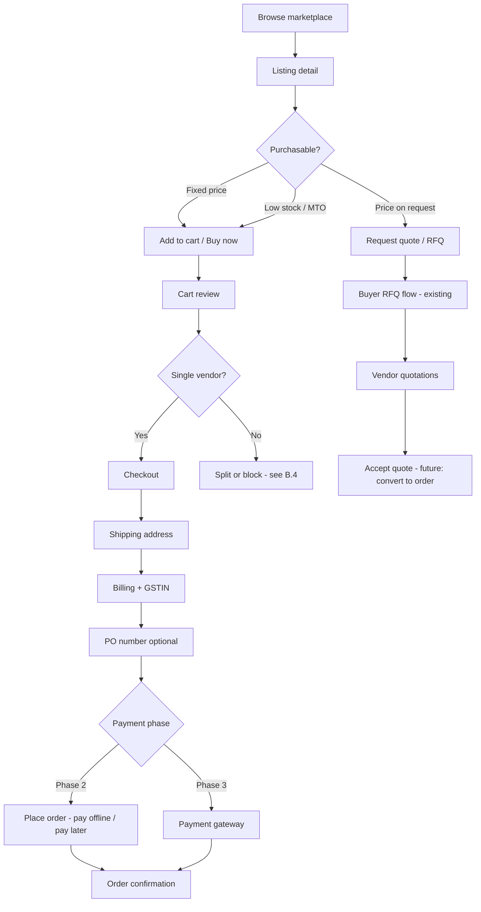

# GarudHub — Checkout Path & Partner Catalog Design

**Status:** Draft for product/engineering alignment  
**Last updated:** 2026-10-06  
**PRD context:** `decode_jwt.docx` (not in repo) — B2B marketplace, partner verification, RFQ → quotations, dashboard modules for leads/orders/payments (Phase E).  
**Working principles:** `PROJECT_WORKING_PRINCIPLES.md` — Phases A–F; platform logic before UI polish; Indian B2B (GST, MOQ, price on request).

---

## 0. Current implementation audit (baseline)

### Backend (NestJS + Prisma)

| Area | What exists | Gaps vs e-commerce |
|------|-------------|-------------------|
| **Catalog** | `PartnerListing` — type, name, brand, category, description, specs, applications, geo, MOQ, `priceInr`, `priceOnRequest`, warranty, `isPublished` | No SKU, images, slug, inventory, shipping, tax, variants, bulk tiers |
| **Marketplace API** | `GET /marketplace/listings`, `GET /marketplace/listings/:id`, `GET /marketplace/partners/:orgId` | No search facets beyond type/category; no cart/checkout |
| **Partner catalog API** | CRUD under `/partner/catalog/listings`; `POST …/listings/images` (JPEG/PNG) | S3/CDN for production |
| **RFQ** | `Rfq`, `RfqInvite`, `Quotation` with price/MOQ/lead time | Parallel path to checkout; no conversion quote → order |
| **Orders / payments** | **None** | Cart, checkout, order states, payment intents, refunds |
| **Uploads** | `OrganizationDocument` + listing images under `UPLOAD_DIR/listings/{orgId}/`; public `GET /media/listings/:orgId/:fileName` | S3 + signed URLs in prod |

### Frontend (Next.js platform)

| Area | What exists | Gaps |
|------|-------------|------|
| **Marketplace** | Browse tabs, `ListingCard`, listing detail, partner profile | Placeholder media (✦); CTA = enquiry link, not cart/RFQ |
| **Partner catalog** | List, new, edit — basics + pricing toggle | MOQ/specs on API but thin in UI; no images/SKU |
| **Buyer** | RFQ create/list/detail | No buyer order history |
| **Types** | `lib/api/types.ts` — auth, RFQ | No cart/order types |

### Phase 1 code delta (this session)

- **Schema:** `sku`, `primaryImageUrl`, `galleryImageUrls[]` on `partner_listings`.
- **UI:** Partner forms + marketplace cards/detail show image URL(s) and optional SKU; price display unchanged (already supported).

### Commerce slice (Option A — fulfillment + listing upload)

- **Schema:** `FulfillmentStatus` on `orders` (`PENDING` → `PROCESSING` → `SHIPPED` → `FULFILLED`); `OrderStatus` remains `CONFIRMED` / `CANCELLED`.
- **API:** `POST /partner/catalog/listings/images` (auth); `GET /media/listings/:orgId/:fileName` (public); `PATCH /partner/orders/:id/fulfillment`.
- **Local storage:** Same env as org docs — `UPLOAD_DIR` (default `./uploads`). Listing files: `uploads/listings/{organizationId}/{uuid}.jpg|png`. Stored URLs in DB use `/platform-api/v1/media/listings/...` for same-origin proxy in dev.
- **UI:** Partner catalog image upload; partner order fulfillment dropdown; buyer orders list/detail show fulfillment badge + short status text.

---

## A. Partner catalog data model

Partners supply catalog data so buyers can **discover**, **compare**, and **purchase or RFQ** with confidence. Fields are grouped by concern; **Required** = must have before marketplace publish (policy); **Optional** = improves conversion.

### A.1 Basics & identity

| Field | Required | DB (current / proposed) | Partner UI | Buyer marketplace | Validation / review |
|-------|----------|---------------------------|------------|-------------------|---------------------|
| Listing type (product/service) | Yes | `listing_type` | New listing | Badge | Enum |
| Name | Yes | `name` | New/Edit | Title | 1–300 chars |
| Brand | Rec. | `brand` | New/Edit | Subtitle | ≤200 chars |
| Category | Yes | `category` | New/Edit | Badge, filters | Enum |
| Description | Rec. | `description` | New/Edit | Body | ≤5000 chars |
| SKU / model code | Optional | `sku` **(Phase 1)** | New/Edit | Detail (B2B ref) | ≤80; unique per org (future index) |
| Slug | Optional | `slug` (proposed) | Auto from name | URL `/marketplace/listings/:slug` | Unique globally; admin override |
| Applications | Optional | `applications[]` | Edit (future) | Tags | String array |
| Technical specs | Optional | `technical_specs` | Edit (future) | Spec block | ≤10000 chars |

### A.2 Media

| Field | Required | DB | Partner UI | Buyer | Validation / review |
|-------|----------|-----|------------|-------|---------------------|
| Primary image | Rec. for publish | `primary_image_url` **(P1)** | URL field | Card + hero | HTTPS URL; later file upload + CDN |
| Gallery | Optional | `gallery_image_urls[]` **(P1)** | Multi-line URLs | Detail carousel | Max 8 URLs; malware scan if uploaded |
| Video URL | Optional | `video_url` (proposed) | URL | Embed | YouTube/Vimeo only (allowlist) |
| Brochure PDF | Optional | `listing_documents` table (proposed) | Upload | Download | Same pipeline as org docs |

**Admin review:** Flag listings with missing primary image or suspicious URLs until automated checks exist.

### A.3 Pricing

| Field | Required | DB | Partner UI | Buyer | Validation |
|-------|----------|-----|------------|-------|------------|
| Price on request | Yes (default true) | `price_on_request` | Checkbox | "Price on request" / RFQ CTA | If false, fixed price required |
| List price (INR) | If not POR | `price_inr` | Number | Card + sidebar | ≥0; 2 decimal |
| Currency | Future | `currency` (proposed, default INR) | Hidden | Display | ISO 4217 |
| MOQ | Rec. | `min_order_quantity` | Number | Detail | ≥1 |
| Bulk price tiers | Optional | `listing_price_tiers` (proposed) | Tier table | Detail table | qty_min, unit_price |
| MRP / compare-at | Optional | `compare_at_price_inr` (proposed) | Number | Strikethrough | ≥ list price |
| Tax inclusive flag | Optional | `price_includes_gst` (proposed) | Checkbox | "Inclusive of GST" | B2B default: ex-GST + GST at checkout |

### A.4 Inventory & fulfillment

| Field | Required | DB | Partner UI | Buyer | Notes |
|-------|----------|-----|------------|-------|-------|
| Stock status | Rec. | `stock_status` enum (proposed) | Select | Badge | `IN_STOCK`, `MADE_TO_ORDER`, `OUT_OF_STOCK` |
| Quantity on hand | Optional | `stock_quantity` (proposed) | Number | "Only X left" | Hide if MTO |
| Lead time (days) | Rec. | `lead_time_days` (proposed) | Number | Checkout ETA | Already on quotations |
| Ships from (city/state) | Optional | `country/state/city` | Address pick | Detail | Exists on listing |
| Delivery zones | Optional | `delivery_zones[]` (proposed) | Multi-select | Shipping estimate | India states / pincode groups |
| Return policy | Optional | `return_policy` (proposed) | Text | Policy link | B2B often custom |

### A.5 Compliance & trust (drone-specific)

| Field | Required | DB | Partner UI | Buyer | Review |
|-------|----------|-----|------------|-------|--------|
| DGCA / NPNT note | Optional | `compliance_notes` (proposed) | Text | Info callout | Informational unless verified badge |
| Cert attachments | Optional | `listing_documents` | Upload | Download | Admin optional review |
| Warranty | Optional | `warranty` | Text | Detail | ≤500 chars |
| HSN / SAC code | Optional | `hsn_code` (proposed) | Text | Invoice (later) | GST invoicing |

### A.6 SEO & discovery

| Field | DB | Partner UI | Buyer |
|-------|-----|------------|-------|
| Slug | proposed | Auto | Canonical URL |
| Meta title / description | proposed | Optional | `<title>` / OG |
| Search keywords | proposed | Tags | Internal search |

### A.7 Publish gates

1. Partner org `verification_status = APPROVED`.
2. Listing `is_published = true`.
3. **Recommended policy:** primary image + description + (fixed price or explicit POR) + MOQ for products.

---

## B. Buyer checkout path (end-to-end)

### B.1 Personas

| Persona | Auth | Checkout behavior |
|---------|------|-------------------|
| **Guest** | None | Browse marketplace; **no cart** in Phase 2+ unless guest checkout approved — default: register/login as `BUYER` or `GOVERNMENT` |
| **Logged-in buyer** | JWT `BUYER` / `GOVERNMENT` | Cart, checkout, order history, GSTIN on org |
| **Enterprise buyer** | Same + `Organization` | PO number, billing/shipping addresses, multi-user (future) |

### B.2 Flow diagram

### B.3 Coexistence with RFQ / price on request

| Listing mode | Primary CTA on detail | Checkout |
|--------------|----------------------|----------|
| `priceOnRequest = false` + in stock | **Add to cart** / Buy now | Standard checkout (Phase 2) |
| `priceOnRequest = true` | **Request quotation** → link to `/buyer/rfqs/new` with listing context (prefill) | No cart line until partner counters via quotation |
| Hybrid (future) | "Add to cart" at quoted price after RFQ award | Order references `quotation_id` |

**Lead routing:** Enquiry PHP / dashboard leads remain for human-assisted deals; RFQ is the structured path for POR listings.

### B.4 Multi-vendor cart policy — **recommendation**

**Default: single-vendor cart** (one `organizationId` per cart).

| Approach | Pros | Cons |
|----------|------|------|
| **Single-vendor (recommended)** | One shipment, one GST invoice per seller, simpler payouts | Buyer checks out multiple times for multiple sellers |
| Multi-vendor split orders | One checkout UX | N invoices, N shipping, commission split, partial failures |

Implementation: on add-to-cart, if `cart.vendorOrgId !== listing.organizationId`, prompt: *"Your cart contains items from {X}. Clear cart or continue shopping with {X}?"*

### B.5 Order model (proposed)

**`Order`**

- `id`, `buyerUserId`, `buyerOrganizationId`, `vendorOrganizationId`
- `status`: `DRAFT` → `PLACED` → `CONFIRMED` → `PROCESSING` → `SHIPPED` → `DELIVERED` → `CANCELLED` / `REFUNDED`
- `paymentStatus`: `PENDING` | `PAID` | `FAILED` | `REFUNDED` (Phase 3)
- `subtotalInr`, `taxInr`, `shippingInr`, `totalInr`
- `gstin`, `billingAddressJson`, `shippingAddressJson`, `purchaseOrderNumber`
- `placedAt`, `metadata` (gateway ids)

**`OrderLineItem`**

- `listingId`, `snapshot` (name, sku, unit price at purchase), `quantity`, `lineTotalInr`

**`Cart` / `CartItem`** (Phase 2): user-scoped, expires after 30 days.

Audit: state transitions logged (mirrors `VerificationAuditLog` pattern).

---

## C. API surface (high level)

### C.1 Reuse today

| Module | Endpoints | Use in checkout |
|--------|-----------|-----------------|
| Catalog / marketplace | `GET /marketplace/listings`, `GET /marketplace/listings/:id` | Product data at cart add |
| Partner catalog | `POST/PATCH /partner/catalog/listings` | Partner maintains SKUs/prices/images |
| Auth | login, refresh, `/partner/me` | Buyer session |
| RFQ | `/rfq/*` | POR listings |
| Documents | `/partner/documents` | Pattern for future `listing` uploads |

### C.2 New modules (by phase)

| Phase | Module | Endpoints (illustrative) |
|-------|--------|--------------------------|
| **1** | Catalog extend | Fields on existing DTOs; optional `POST /partner/catalog/listings/:id/images` later |
| **2** | Cart | `GET/POST/PATCH/DELETE /buyer/cart`, `POST /buyer/cart/items`, `DELETE /buyer/cart/items/:id` |
| **2** | Checkout | `POST /buyer/checkout/preview` (tax/shipping stub), `POST /buyer/checkout/place` |
| **2** | Orders | `GET /buyer/orders`, `GET /buyer/orders/:id`, `GET /partner/orders`, `PATCH /partner/orders/:id/status` |
| **3** | Payments | `POST /buyer/orders/:id/pay`, webhooks `/webhooks/payments/*` (Razorpay / Vistarkriya per live site) |
| **3** | Uploads | `POST /partner/catalog/listings/:id/media` (multipart → S3/R2) |

**Authorization:** `BUYER`/`GOVERNMENT` for cart/checkout; `PARTNER` for vendor order updates; `PLATFORM_ADMIN` for disputes.

---

## D. Phased implementation plan

### Phase 1 — Partner images + fixed pricing display (no payment) ✅ partial in repo

- [x] DB: `sku`, `primary_image_url`, `gallery_image_urls`
- [x] Partner new/edit: image URLs, SKU, existing price/MOQ paths
- [x] Marketplace card/detail: show image when URL set
- [ ] Expand partner edit for MOQ, specs (API already supports)
- [ ] Seed/demo listings with images for QA
- [ ] Admin queue: unpublished listings missing primary image (optional)

### Phase 2 — Cart + checkout + orders (offline / pay later) ✅ implemented

- **Schema:** `Cart` / `CartItem` (single `partnerOrganizationId` per cart), `Order` / `OrderLineItem` with listing snapshots; `OrderStatus` (`CONFIRMED`, `CANCELLED`) + `PaymentStatus` (`PENDING` default on place — pay offline).
- **APIs:** `GET/POST/PATCH/DELETE /buyer/cart`, `POST /buyer/checkout/place`, `GET /buyer/orders`, `GET /partner/orders`; 409 when mixing vendors.
- **UI:** `/buyer/cart`, `/buyer/checkout`, `/buyer/orders`, listing **Add to cart** for fixed price; header cart count for buyers.
- **Not in Phase 2:** payment gateway, email stub, partner orders UI (API only).

### Phase 3 — Payment gateway

- Integrate gateway (align with garudhub.com / Vistarkriya)
- Idempotent pay endpoint + webhooks
- Refunds/cancellations policy
- Subscription for partner tiers (blueprint dashboard) — separate from product checkout

### Phase 4+ (out of scope here)

- Multi-currency, pincode shipping tables, WMS inventory sync, quote-to-order, guest checkout

---

## E. Open product decisions

1. **Single-vendor cart** vs multi-vendor split — **recommend single-vendor** (see B.4).
2. Guest checkout allowed? **Default: no** — B2B needs org + GSTIN.
3. Services (training/repair) in cart vs RFQ-only? **Default: RFQ or "enquire"** until service SKU pricing is common.
4. Image hosting: partner-supplied URLs vs mandatory Garud CDN upload — **Phase 1 URLs**; Phase 1b upload API.

---

## F. Manual test checklist (Phase 1)

1. Partner approved → create listing with primary image URL + fixed price → publish.
2. Marketplace card shows image and price; detail shows gallery.
3. POR listing still shows "Price on request" and enquiry/RFQ path unchanged.
4. Unapproved partner cannot publish (existing).

---

*Document owner: engineering; align with client on cart policy before Phase 2.*
