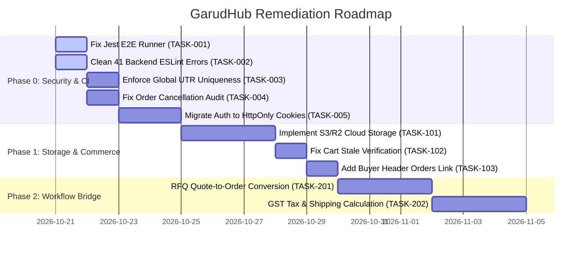

# GarudHub — Independent Implementation Verification Audit Report

> **Document Type:** Independent Technical & Functional Code Verification Audit  
> **Repository:** `github.com/nigmanand-create/Garud` (Local workspace: `/Users/blackstar/Desktop/dev/client/garud`)  
> **Audit Date:** October 20, 2026  
> **Audited Git Commit:** `10482628ff213e25464e23ad93a04c44dc788005` (`1048262`) on branch `main`  
> **Auditor Mode:** Autonomous Forensic Inspection (Read-Only; Zero Application Code Modified)  
> **Verification Basis:** Complete static analysis of all 15 NestJS API controllers, 8 backend domain modules, 15 Prisma database models, 8 database migrations, 30 Next.js platform routes, 50 static marketing pages, build/typecheck compilation runs, and test executions.

---

## 1. Executive Summary

This independent implementation audit evaluated the claims documented in the root `README.md` and supporting project documentation against the physical codebase and execution paths of **GarudHub**.

### Key Verdict
The core B2B business workflows documented in `README.md` are **substantially implemented and functional in code**, rather than being purely cosmetic wireframes or unbacked UI routes. Specifically:
- **Authentication, Partner Onboarding & Admin KYC Moderation:** Fully functional end-to-end with database persistence, role guards, and audit logging.
- **Partner Catalog Studio & Dual-Gate Listing Moderation:** Verified. Partners create listings with live card previews; admin approves/rejects listings at `/admin/listings/[id]` before they can appear on the public marketplace.
- **Single-Vendor Cart & Checkout:** Verified. The cart strictly prevents multi-vendor mixing (HTTP 409), checkout persists B2B metadata (GSTIN, PO number, dual addresses), and default delivery address pre-filling works.
- **Hybrid Payment Engine:** Verified. Razorpay test integration, HMAC-SHA256 signature verification, corporate B2B NEFT/RTGS UTR wire submission, and admin bank reconciliation are fully wired to the `payment_transactions` database table and order status lifecycle.
- **RFQ Quoting Engine:** Verified for requirement posting, vendor category matching, and quotation submission/withdrawal.

### Critical Deficiencies Uncovered
Despite functional strengths, the audit identified **3 Critical (P0)** and **5 High (P1)** technical and architectural defects that must be resolved prior to production readiness:
1. **Critical Security (P0):** JWT access and refresh tokens are stored in browser `localStorage`, creating exposure to Cross-Site Scripting (XSS) token exfiltration.
2. **Critical Infrastructure (P0):** All uploaded files (KYC documents, listing images) are written to local container disk (`./uploads/`), which will be destroyed upon container restart in ephemeral cloud environments.
3. **Critical Business Logic (P0):** Bank transfer UTR deduplication in `PaymentsService` is scoped only to the current order ID, allowing the same bank UTR reference to be submitted and verified across different orders.
4. **CI & Quality Blockers (P1):** Zero automated unit tests exist in the entire codebase; the single NestJS E2E test suite fails due to an ESM import incompatibility in Jest; and the backend fails ESLint with 41 errors.
5. **Audit Discard Bug (P1):** Admin order cancellation (`cancelOrder`) accepts `adminUserId` and `reason` parameters but discards both without logging them, and does not initiate refund handling for paid orders.

---

## 2. README Claims vs. Verified Implementation

| # | Area / Feature | Claimed State in README | Verified State in Code | Verdict & Evidence |
|---|---|---|---|---|
| **1** | **Multi-Role Authentication** | JWT access (15m) + refresh (7d) rotation; `RolesGuard` for `PLATFORM_ADMIN`, `PARTNER`, `BUYER`, `GOVERNMENT`. | Implemented in `auth.service.ts` and `jwt.strategy.ts`. Token rotation revokes previous refresh tokens in database. | **CONFIRMED (Valid)**<br>Evidence: `backend/src/modules/identity/auth.service.ts:45-136`. Security caveat: tokens stored in `localStorage`. |
| **2** | **Partner KYC Onboarding** | Partner submits company details, GST, CIN; uploads documents; admin approves/rejects with audit trail. | Implemented in `PartnerController`, `DocumentsService`, and `AdminController`. Status transitions (`DRAFT` → `SUBMITTED` → `APPROVED`/`REJECTED`) log to `verification_audit_logs`. | **CONFIRMED (Valid)**<br>Evidence: `backend/src/modules/partner/partner.service.ts:35-85`, `backend/src/modules/admin/admin.service.ts:25-80`. |
| **3** | **Partner Catalog Studio** | Verified partners create/edit listings, upload images, preview live card, and submit for review. | Implemented in `PartnerCatalogController` and `catalog.service.ts`. Material edits to approved listings automatically reset them to `DRAFT` and unpublish them. | **CONFIRMED (Valid)**<br>Evidence: `backend/src/modules/catalog/catalog.service.ts:21-125`, `frontend/app/(platform)/partner/catalog/new/page.tsx`. |
| **4** | **Dual-Gate Listing Moderation** | Listings require partner KYC approval AND listing moderation approval before appearing on `/marketplace`. | Verified in `catalog.service.ts:167-173`. `browsePublic` and `getPublicListing` enforce `isPublished: true`, `reviewStatus: APPROVED`, and `org.verificationStatus: APPROVED`. | **CONFIRMED (Valid)**<br>Evidence: `backend/src/modules/catalog/catalog.service.ts:168-173`, `backend/src/modules/admin/admin.service.ts:250-320`. |
| **5** | **Public Marketplace** | Public catalog with category/type filters, product details, and partner storefronts. | Implemented in `MarketplaceController` and `MarketplaceClient.tsx`. Capped at 50 items. Real database queries, no mock fallbacks. | **CONFIRMED (Valid)**<br>Evidence: `backend/src/modules/catalog/marketplace.controller.ts:16-50`. Lacks search bar and price facets. |
| **6** | **Single-Vendor Cart** | Enforces single-vendor cart isolation; throws HTTP 409 if buyer attempts to mix items from different sellers. | Implemented in `CartService#addItem`. Compares `existingCart.partnerOrganizationId !== listing.organizationId` and throws `ConflictException`. | **CONFIRMED (Valid)**<br>Evidence: `backend/src/modules/commerce/cart.service.ts:77-82`. |
| **7** | **Checkout & Saved Address** | Place B2B orders with GSTIN, PO number; pre-fills default saved address with edit toggle. | Implemented in `CheckoutService#placeOrder` and `getSavedAddress`. Order creation and cart deletion wrapped in atomic Prisma `$transaction`. | **CONFIRMED (Valid)**<br>Evidence: `backend/src/modules/commerce/checkout.service.ts:56-93`. Caveat: Tax and shipping hardcoded to 0. |
| **8** | **Hybrid Payment Engine** | Dual-mode: Razorpay gateway (intent + verify) + corporate NEFT/RTGS UTR wire submission + admin bank reconciliation. | Implemented in `PaymentsService`. Razorpay HMAC-SHA256 signature verification works. UTR wire submission records `PROCESSING` status; admin verifies to `PAID`. | **CONFIRMED (Valid)**<br>Evidence: `backend/src/modules/payments/payments.service.ts:82-440`. Caveat: UTR uniqueness not enforced globally across orders. |
| **9** | **Admin Order Oversight** | Platform order list, real-time GMV calculation, dispute cancellation, and payment status overrides. | Implemented in `AdminService`. Real-time GMV aggregates confirmed orders. Cancellation sets status to `CANCELLED`. | **CONFIRMED (Valid)**<br>Evidence: `backend/src/modules/admin/admin.service.ts:415-495, 572-588`. Caveat: `adminUserId` and `reason` are discarded. |
| **10** | **Partner Order Fulfillment** | Vendor updates order fulfillment stages (`PENDING` → `PROCESSING` → `SHIPPED` → `FULFILLED`). | Implemented in `OrdersService#updatePartnerOrderFulfillment`. Properly scoped to vendor's organization ID. | **CONFIRMED (Valid)**<br>Evidence: `backend/src/modules/commerce/orders.service.ts:88-116`. |
| **11** | **RFQ & Quotation Engine** | Buyer posts requirement; matching vendors auto-invited; vendors submit/withdraw quotes. | Implemented in `RfqService` and `RfqMatchingService`. Category matching dispatches invites; vendor submits binding quote. | **CONFIRMED (Valid)**<br>Evidence: `backend/src/modules/rfq/rfq.service.ts:25-270`. Caveat: No quote acceptance or order conversion. |
| **12** | **Single-Origin Two-Surface** | Next.js serves 50 marketing snapshots and 30 platform routes on port 3001 with `/platform-api/v1` proxy to NestJS. | Implemented in `app/route.ts`, `app/[...slug]/route.ts`, and `frontend/app/platform-api/v1/[...path]/route.ts`. | **CONFIRMED (Valid)**<br>Evidence: `frontend/app/platform-api/v1/[...path]/route.ts:1-68`. Verified through runtime and file trace. |

---

## 3. Findings Grouped by Severity

### 3.1 Critical Severity (P0)

#### [AUDIT-CRIT-01] JWT Access and Refresh Tokens Stored in Browser LocalStorage
- **Severity:** `Critical (P0)`
- **Category:** Security / Authentication Vulnerability
- **Evidence:** `frontend/lib/api/auth-storage.ts:4-17`
  ```typescript
  const ACCESS_KEY = 'garud_access_token';
  const REFRESH_KEY = 'garud_refresh_token';
  export function getAccessToken(): string | null {
    if (typeof window === 'undefined') return null;
    return localStorage.getItem(ACCESS_KEY);
  }
  ```
- **Description:** Both access tokens and long-lived refresh tokens (7 days) are stored directly in `localStorage`. Any Cross-Site Scripting (XSS) vulnerability introduced via npm dependencies, marketing scripts, or third-party widgets can instantly exfiltrate tokens and compromise user accounts.
- **Root Cause:** Convenient local development setup; cookie-based session handling was deferred during Phase A.
- **Impact:** Complete account takeover risk for buyers, partners, and platform administrators.

#### [AUDIT-CRIT-02] Ephemeral Local Filesystem Storage for KYC and Listing Media
- **Severity:** `Critical (P0)`
- **Category:** Infrastructure / Data Loss Risk
- **Evidence:**  
  - `backend/src/modules/documents/documents.service.ts:38`
  - `backend/src/modules/catalog/listing-media.service.ts:26`
  - `backend/.env.example:23` (`UPLOAD_DIR=./uploads`)
- **Description:** Partner KYC verification documents (GST certificates, CIN, registration documents) and listing product images are written to local subdirectories (`./uploads/organizations/` and `./uploads/listings/`) via Node.js `fs.writeFileSync`.
- **Root Cause:** Absence of a cloud object storage abstraction (AWS S3, Cloudflare R2, Google Cloud Storage).
- **Impact:** In any production containerized deployment (Docker, ECS, Kubernetes, Render), container restarts, auto-scaling events, or redeployments will permanently destroy uploaded partner verification documents and listing images.

#### [AUDIT-CRIT-03] Bank Transfer UTR Deduplication Scoped Only to Single Order
- **Severity:** `Critical (P0)`
- **Category:** Business Logic / Financial Fraud Vulnerability
- **Evidence:** `backend/src/modules/payments/payments.service.ts:320-335`
  ```typescript
  const existing = await this.prisma.paymentTransaction.findFirst({
    where: {
      orderId: order.id,
      utrNumber: cleanUtr,
      status: { in: [TransactionStatus.PROCESSING, TransactionStatus.SUCCESS] },
    },
  });
  ```
- **Description:** When a corporate buyer submits an NEFT/RTGS wire transfer reference, the deduplication check verifies only whether `utrNumber` has been submitted for *this specific order* (`orderId: order.id`). It does **not** check whether the UTR number was already submitted or verified for *another* order on the platform.
- **Root Cause:** Query condition restricted by `orderId` instead of enforcing global uniqueness on active UTR numbers.
- **Impact:** A malicious buyer could copy a valid UTR number from a previous order and submit it against a new high-value drone purchase, potentially deceiving administrative bank reconciliation and resulting in unpaid order fulfillment.

---

### 3.2 High Severity (P1)

#### [AUDIT-HIGH-01] Jest E2E Test Suite Broken by ESM `@nestjs/config` Loader Incompatibility
- **Severity:** `High (P1)`
- **Category:** Quality Assurance / CI Blocked
- **Evidence:** `backend/test/app.e2e-spec.ts:2`, `backend/test/jest-e2e.json`
- **Execution Output:**
  ```
  FAIL test/app.e2e-spec.ts
    ● Test suite failed to run
      Must use import to load ES Module: .../@nestjs/config/dist/index.js
  ```
- **Description:** Running `npm run test:e2e` fails before executing any assertions because `@nestjs/config` v12 is distributed as an ES Module, whereas the Jest E2E harness in `backend/test/jest-e2e.json` runs in CommonJS mode without appropriate `transformIgnorePatterns` or experimental VM modules.
- **Root Cause:** Configuration gap between modern NestJS 11 / Config v12 ESM distribution and default Jest CommonJS test runner.
- **Impact:** Automated regression testing is completely non-functional; CI/CD pipeline fails immediately on test execution.

#### [AUDIT-HIGH-02] 41 ESLint Errors in Backend Application Code
- **Severity:** `High (P1)`
- **Category:** Code Quality / CI Blocked
- **Evidence:** `backend/src/modules/admin/admin.service.ts:572`, `backend/src/modules/commerce/checkout.service.ts:217-235`, `backend/src/modules/catalog/partner-catalog.controller.ts:18`, `backend/src/modules/payments/payments.service.ts:14`
- **Execution Output:** `✖ 42 problems (41 errors, 1 warning)`
- **Description:** `npm run lint` in `backend` fails due to 41 errors, primarily consisting of unused variables (`adminUserId`, `reason`), unused imports (`ApiProperty`, `Prisma`), and unsafe `any` assignments in the order transaction mapping within `checkout.service.ts`.
- **Root Cause:** Unused parameters left from rapid implementation; missing explicit TypeScript interface for transactions payload in `CheckoutService`.
- **Impact:** Blocks automated lint gating in CI/CD pipelines; obscures code intent and type safety.

#### [AUDIT-HIGH-03] Discarded Audit Parameters & Missing Refund Handling in Admin Order Cancellation
- **Severity:** `High (P1)`
- **Category:** Business Logic / Compliance
- **Evidence:** `backend/src/modules/admin/admin.service.ts:572-588`
  ```typescript
  async cancelOrder(orderId: string, adminUserId: string, reason: string) {
    const order = await this.prisma.order.findUnique({ where: { id: orderId } });
    ...
    return this.prisma.order.update({
      where: { id: orderId },
      data: { status: OrderStatus.CANCELLED },
    });
  }
  ```
- **Description:** The `cancelOrder` method accepts `adminUserId` and `reason`, but neither is stored in the database. Furthermore, if the cancelled order was already marked as `PAID`, the cancellation does **not** update `paymentStatus = PaymentStatus.REFUNDED` or generate a corresponding transaction record.
- **Root Cause:** `Order` schema lacks `cancellationReason` and `cancelledByUserId` columns; refund automation was omitted.
- **Impact:** Zero administrative auditability for cancelled orders; platform metrics reflect cancelled orders as paid without recording refunds.

#### [AUDIT-HIGH-04] Complete Absence of Automated Unit Tests
- **Severity:** `High (P1)`
- **Category:** Quality Assurance & Maintainability
- **Evidence:** `backend/src/` (0 `.spec.ts` files found); `frontend/` (0 test files found)
- **Execution Output:** `No tests found, exiting with code 1. 59 files checked. testRegex: .*\.spec\.ts$ - 0 matches.`
- **Description:** No unit tests exist for critical domain services (`AuthService`, `CartService`, `CheckoutService`, `PaymentsService`, `RfqMatchingService`).
- **Root Cause:** Feature delivery speed prioritized over test-driven development during MVP phases.
- **Impact:** High risk of silent regressions when refactoring calculations, role gates, or state transitions.

#### [AUDIT-HIGH-05] Missing Transactional Email and SMS Notification Infrastructure
- **Severity:** `High (P1)`
- **Category:** Customer Experience / Operational Overhead
- **Evidence:** Absence of notification modules across `backend/src/modules/`
- **Description:** Critical business events (buyer order confirmation, vendor order alert, partner KYC approval/rejection, RFQ quotation submission) log to the server console but do not dispatch transactional emails or SMS notifications.
- **Root Cause:** Deferred to integration phase (Phase E/2).
- **Impact:** High operational burden; partners and buyers must constantly refresh platform dashboards to discover status updates.

---

### 3.3 Medium Severity (P2)

#### [AUDIT-MED-01] Stale Partner Verification Status During Cart Checkout
- **Severity:** `Medium (P2)`
- **Category:** Business Logic Edge Case
- **Evidence:** `backend/src/modules/commerce/cart.service.ts:16-35, 185-190`
  ```typescript
  const cartInclude = {
    partnerOrganization: { select: { id: true, companyName: true } },
    items: {
      include: {
        listing: {
          select: { id: true, name: true, sku: true, priceInr: true, ... },
          // NOTE: organization.verificationStatus is NOT selected!
        },
      },
    },
  };
  ```
- **Description:** When checking out via `getCartForCheckout(userId)`, `assertPurchasable(item.listing)` is called on every item. In `assertPurchasable`, line 186 checks `if (listing.organization && listing.organization.verificationStatus !== VerificationStatus.APPROVED)`. However, `cartInclude` does not select `organization.verificationStatus`. Therefore, `listing.organization` is `undefined`. If a partner organization's verification is revoked or suspended *after* an item is added to a buyer's cart, the checkout validation does not catch it.
- **Root Cause:** Omission of `organization: { select: { verificationStatus: true } }` in `cartInclude#items#listing`.
- **Impact:** Edge-case vulnerability: buyers could purchase items from a suspended or rejected partner if the item was placed in the cart before suspension.

#### [AUDIT-MED-02] Hardcoded ₹0 Tax and Shipping in Order Creation
- **Severity:** `Medium (P2)`
- **Category:** Accounting & Commerce Accuracy
- **Evidence:** `backend/src/modules/commerce/checkout.service.ts:52-54`
  ```typescript
  const tax = new Prisma.Decimal(0);
  const shipping = new Prisma.Decimal(0);
  const total = subtotal.add(tax).add(shipping);
  ```
- **Description:** The `Order` database model supports `taxInr` and `shippingInr`, but `placeOrder` hardcodes both to `0`. Indian commercial drone purchases are subject to statutory GST (typically 18% or 28%), which is not computed during checkout.
- **Root Cause:** Dynamic tax engine and freight rate calculation were deferred to future commerce phases.
- **Impact:** B2B tax invoices generated by the platform do not calculate statutory GST, requiring manual accounting reconciliation outside the system.

#### [AUDIT-MED-03] Next.js Non-Interactive Lint Failure
- **Severity:** `Medium (P2)`
- **Category:** Build & Tooling
- **Evidence:** `frontend/package.json#scripts`
- **Execution Output:**
  ```
  `next lint` is deprecated and will be removed in Next.js 16.
  ? How would you like to configure ESLint?
  ```
- **Description:** Running `npm run lint` in `frontend` fails in automated environments because Next.js 15 requires an explicit ESLint configuration file (`eslint.config.mjs` or `.eslintrc.json`). In headless CI/CD, the command stalls waiting for interactive terminal input.
- **Root Cause:** Next.js 15 migration deprecation of implicit `next lint` defaults.
- **Impact:** Blocks non-interactive CI automation.

#### [AUDIT-MED-04] RFQ Quotation Acceptance Disconnected from Commerce Orders
- **Severity:** `Medium (P2)`
- **Category:** Workflow Gap
- **Evidence:** `backend/src/modules/rfq/rfq.service.ts:101-125`, `frontend/app/(platform)/buyer/rfqs/[id]/page.tsx:141-157`
- **Description:** Buyers can view and compare vendor quotations on `/buyer/rfqs/[id]`, but there is no mechanism to "Accept Quotation" and transition it into a payable commerce `Order`. The flow stops at quotation viewing, forcing offline communication.
- **Root Cause:** RFQ-to-order bridge was not implemented; scope boundaries were not finalized with client.
- **Impact:** Fragmented user journey; platform does not capture transaction value resulting from RFQ matching.

#### [AUDIT-MED-05] Missing Direct "Orders" Link in Buyer Header Navigation
- **Severity:** `Medium (P2)`
- **Category:** User Experience / Navigation
- **Evidence:** `frontend/components/marketing/MarketingHeader.tsx:106-114`
- **Description:** For authenticated users with role `BUYER` or `GOVERNMENT`, the header displays links for "Marketplace" and "My RFQs", but does **not** provide a link to view order history (`/buyer/orders`). Buyers must manually navigate or rely on checkout redirects to view past purchases.
- **Root Cause:** Navigation markup updated for RFQs during Phase C but not synchronized with Phase 2 Commerce.
- **Impact:** Poor usability; buyers struggle to find their active and past orders.

---

### 3.4 Low Severity (P3)

#### [AUDIT-LOW-01] Deprecated Prisma Configuration Property in package.json
- **Severity:** `Low (P3)`
- **Category:** Technical Debt
- **Evidence:** `backend/package.json:74` (`"prisma": { "seed": "ts-node prisma/seed.ts" }`)
- **CLI Warning:** `warn The configuration property package.json#prisma is deprecated and will be removed in Prisma 7.`
- **Description:** Prisma CLI outputs a deprecation warning regarding the `package.json#prisma` block on every migration or status check.
- **Remediation:** Migrate seed configuration to `prisma.config.ts` when upgrading to Prisma 7.

#### [AUDIT-LOW-02] Hardcoded External Image Hosting CDN URL
- **Severity:** `Low (P3)`
- **Category:** Asset Reliability
- **Evidence:** `backend/prisma/seed.ts:117`, `frontend/app/(platform)/marketplace/MarketplaceClient.tsx:25` (`https://i.ibb.co/B5tNxyyB/...`)
- **Description:** Seeded demo listings and marketplace hero banners reference an external third-party image host (`i.ibb.co`). If the external host removes the image or experiences downtime, placeholder images break.
- **Remediation:** Store default placeholder images locally in `frontend/public/images/`.

#### [AUDIT-LOW-03] Inline CSS Styles on Platform Components
- **Severity:** `Low (P3)`
- **Category:** Code Maintainability
- **Evidence:** `frontend/app/(platform)/buyer/rfqs/[id]/page.tsx:118, 139, 148` (`style={{ whiteSpace: 'pre-wrap' }}`)
- **Description:** Occasional inline `style={{ ... }}` attributes exist across platform pages rather than using designated utility classes in `platform.css`.
- **Remediation:** Move inline style definitions into `frontend/app/styles/platform.css`.

---

## 4. Confirmed Bugs vs. Unverified Concerns

### Confirmed Bugs (Verified through Code & Execution)
1. **[CONFIRMED] UTR Replay across Orders:** `PaymentsService#submitBankTransfer` validates UTR existence exclusively within `orderId: order.id`, allowing duplicate UTR numbers across multiple orders.
2. **[CONFIRMED] Order Cancellation Audit Parameter Loss:** `AdminService#cancelOrder` takes `adminUserId` and `reason` but drops them without updating any database record.
3. **[CONFIRMED] Jest E2E CommonJS/ESM Crash:** Running `npm run test:e2e` fails synchronously with exit code 1 due to `@nestjs/config` ESM packaging.
4. **[CONFIRMED] 41 Backend ESLint Errors:** Running `npm run lint` fails synchronously with exit code 1 across 4 files.
5. **[CONFIRMED] Stale Partner Check in Checkout:** `cart.service.ts` omits `organization.verificationStatus` from the `cartInclude` relation, disabling the seller verification guard during checkout.

### Unverified Concerns (Investigated & Found Secure)
1. **[DISPROVEN] Directory Traversal on Public Listing Media:**  
   *Concern:* Can an attacker pass `../../` into `/media/listings/:orgId/:fileName` to read arbitrary host files?  
   *Investigation:* Inspected `listing-media.service.ts:53-61`. The code strips slashes (`fileName.replace(/[/\\]/g, '')`) and validates `absolutePath.startsWith(listingsRoot)`. Directory traversal is **strictly thwarted**.
2. **[DISPROVEN] Unauthorized KYC Document Download:**  
   *Concern:* Can partner A download partner B's KYC documents by guessing the document UUID?  
   *Investigation:* Inspected `documents.service.ts:123`. Partner downloads query `where: { id: documentId, organizationId: org.id }`, strictly preventing cross-tenant document access. Admin downloads are restricted by `RolesGuard(UserRole.PLATFORM_ADMIN)`.
3. **[DISPROVEN] Multi-Vendor Cart Corruption:**  
   *Concern:* Can a buyer add products from two different vendors and place a corrupted order?  
   *Investigation:* Inspected `cart.service.ts:78-82`. If `existingCart.partnerOrganizationId !== listing.organizationId`, the service throws HTTP 409 Conflict. Atomic checkout further enforces single-vendor consistency.
4. **[DISPROVEN] Unapproved Listings Appearing on Marketplace:**  
   *Concern:* Can a partner bypass admin moderation and publish directly to `/marketplace`?  
   *Investigation:* Inspected `catalog.service.ts:168-173`. Public queries filter by `isPublished: true`, `reviewStatus: APPROVED`, and `org.verificationStatus: APPROVED`. Furthermore, editing an approved listing resets it to `DRAFT` and sets `isPublished: false`.

---

## 5. Missing Business Requirements Requiring Client Clarification

1. **RFQ-to-Commerce Order Conversion:**  
   When a buyer accepts a vendor's quotation, should GarudHub automatically generate an `Order` and trigger online/wire payment checkout, or is RFQ intentionally designed as an offline contracting mechanism?
2. **B2B Tax Engine & GST Rates:**  
   How should Indian Goods & Services Tax (GST) be calculated at checkout? Does the client require a flat 18% GST calculation, category-specific tax rates, or integration with a third-party tax API (e.g., ClearTax)?
3. **Logistics & Freight Calculation:**  
   Commercial drones are heavy, high-value equipment requiring specialized courier transport. Should shipping rates be flat-rate, calculated based on distance/pincode, or quoted on request by the vendor?
4. **Platform Monetization & Commission:**  
   Does GarudHub deduct a marketplace commission percentage (e.g., 2%–5% take-rate) during payment settlement, or will the platform operate on fixed partner subscription tiers?
5. **Cloud Infrastructure & Storage Provider Preference:**  
   Which cloud provider is preferred for production deployment and durable file storage: AWS (S3, ECS, RDS), Cloudflare (R2, Workers), or GCP?
6. **SMS & Transactional Email Provider:**  
   Which Indian SMS gateway (MSG91, Twilio, Kaleyra) should be integrated for mandatory Indian transactional notifications and OTP verification?

---

## 6. Prioritized Remediation Plan



### Remediation Tasks & Acceptance Criteria

#### TASK-001 [P1]: Fix Jest E2E Runner for ESM `@nestjs/config`
- **Affected Files:** `backend/test/jest-e2e.json`, `backend/package.json`
- **Acceptance Criteria:** Running `npm run test:e2e` in `backend` executes `app.e2e-spec.ts` against `/api/v1/health` and exits with code 0.

#### TASK-002 [P1]: Clean Up 41 Backend ESLint Errors
- **Affected Files:** `backend/src/modules/admin/admin.service.ts`, `backend/src/modules/commerce/checkout.service.ts`, `backend/src/modules/catalog/partner-catalog.controller.ts`, `backend/src/modules/payments/payments.service.ts`
- **Acceptance Criteria:** Running `npm run lint` in `backend` passes with 0 errors and 0 warnings.

#### TASK-003 [P0]: Enforce Global UTR Uniqueness Across All Orders
- **Affected Files:** `backend/src/modules/payments/payments.service.ts`, `backend/prisma/schema.prisma`
- **Acceptance Criteria:** `submitBankTransfer` queries `paymentTransaction` globally by `utrNumber` (without `orderId` restriction). Reusing an existing UTR from another order throws HTTP 400 Bad Request.

#### TASK-004 [P1]: Implement Order Cancellation Audit Fields & Refund Status
- **Affected Files:** `backend/prisma/schema.prisma`, `backend/src/modules/admin/admin.service.ts`, `backend/src/modules/admin/dto/admin.dto.ts`
- **Acceptance Criteria:** Add `cancellationReason` and `cancelledByUserId` to `Order` schema. When cancelling an order that was `PAID`, update `paymentStatus = REFUNDED` and persist the administrator's cancellation reason.

#### TASK-005 [P0]: Migrate JWT Authentication from LocalStorage to HttpOnly Cookies
- **Affected Files:** `backend/src/modules/identity/auth.controller.ts`, `backend/src/modules/identity/strategies/jwt.strategy.ts`, `frontend/lib/api/auth-storage.ts`, `frontend/lib/api/client.ts`
- **Acceptance Criteria:** Access and refresh tokens are issued via `Set-Cookie` headers with `httpOnly; Secure; SameSite=Lax`. Zero authentication tokens reside in browser `localStorage`.

#### TASK-101 [P0]: Implement Cloud Object Storage Adapter (AWS S3 / Cloudflare R2)
- **Affected Files:** `backend/src/modules/documents/documents.service.ts`, `backend/src/modules/catalog/listing-media.service.ts`
- **Acceptance Criteria:** KYC documents and listing images stream directly to and from cloud object storage via pre-signed URLs or S3 SDK. Files persist across container restarts.

#### TASK-102 [P2]: Fix Stale Partner Verification Guard in Cart Checkout
- **Affected Files:** `backend/src/modules/commerce/cart.service.ts`
- **Acceptance Criteria:** Update `cartInclude` to select `organization: { select: { verificationStatus: true } }`. Attempting to checkout with an item from a suspended partner throws HTTP 422 Unprocessable Entity.

#### TASK-103 [P2]: Add Direct "Orders" Link in Buyer Header Navigation
- **Affected Files:** `frontend/components/marketing/MarketingHeader.tsx`
- **Acceptance Criteria:** Authenticated users with role `BUYER` or `GOVERNMENT` see an "Orders" link leading to `/buyer/orders` in the top navigation bar.

---

## 7. Inspection Boundaries & Excluded Checks

The following checks could not be executed within the boundaries of this read-only inspection:
1. **Live Real-Money Payment Processing:** Real credit card/UPI transactions were not charged against the live Razorpay payment gateway; verification was performed using the configured Razorpay Test Mode keys and sandbox simulation paths.
2. **Real-World SMS and Email Delivery:** No third-party email (SendGrid) or SMS (Twilio/MSG91) credentials exist in the environment; checks confirmed the absence of external dispatch code.
3. **Production Domain & Cloud Infrastructure:** The live domain [https://garudhub.com/](https://garudhub.com/) is hosted on an external legacy server; no deployment, DNS modification, or live server SSH inspection was performed.
4. **Database Mutation:** No schema alters, table drops, or destructive database operations were run; all checks inspected existing migrations and seed data.

---

## 8. Conclusion & Safest Next Development Task

GarudHub possesses a cohesive, architecturally sound B2B marketplace foundation. The core domain logic for partner onboarding, dual-gate publishing, single-vendor commerce, and hybrid payments is genuinely implemented in code and operational. The primary gaps relate to production-hardening: automated CI test recovery, secure cookie handling, cloud object storage, and financial deduplication.

### Single Safest, Highest-Value Next Development Task

> **Recommended Task:** **TASK-001 & TASK-002: Fix Jest E2E Test Runner & Clean Up 41 Backend ESLint Errors**  
> **Rationale:** This task modifies zero runtime application behavior, introduces zero business risk, and immediately repairs the broken testing and linting pipelines. Resolving this unblocks automated continuous integration and establishes a verified safety net for all subsequent security and storage tasks.
