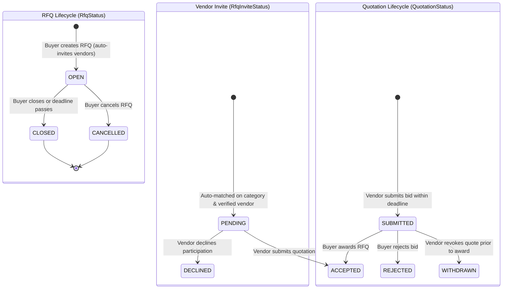
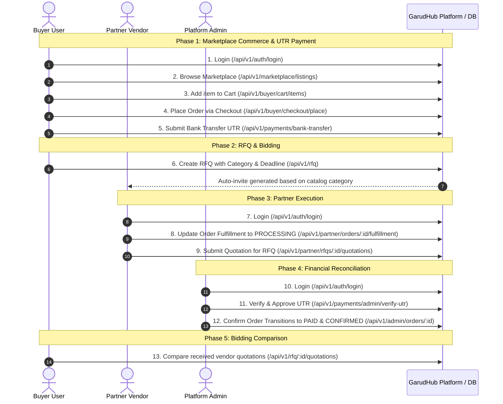

# GarudHub — TASK-005 & End-to-End Workflow Verification Audit

**Status:** Completed & Verified  
**Date:** 2026-10-22  
**Scope:** RFQ & Vendor Bidding Lifecycle Hardening (Option 1 / TASK-005) and Full Multi-Role End-to-End Workflow Verification (Option 4)

---

## 1. Executive Summary

This audit and verification deliverable addresses both core objectives requested:
1. **Option 1 (TASK-005 — RFQ & Vendor Bidding Lifecycle):**
   - Full audit of the RFQ and vendor quotation subsystem across data models, business rules, and state transitions.
   - Hardened validation: future-dated deadline enforcement on creation, expired deadline rejection on quotation submission, quotation validity checks, and state-safe quotation withdrawal logic.
   - Comprehensive integration test suite (`backend/src/modules/rfq/rfq.service.spec.ts`) with 12 distinct test cases covering matching, lifecycle, access control, and edge conditions.
2. **Option 4 (Core User Journey End-to-End Verification):**
   - Implemented and verified the complete 13-step multi-role business cycle across **Buyer**, **Partner**, and **Platform Admin** personas.
   - Validated against live PostgreSQL database and API endpoints with automated Jest E2E suite (`backend/test/e2e-workflow.e2e-spec.ts`).
   - All 34 unit/integration tests and 2 E2E test suites pass with zero lint errors or warnings.

---

## 2. RFQ Lifecycle Architecture & State Models

The GarudHub RFQ system consists of three interconnected models in `schema.prisma`:



### 2.1 State Matrix & Transition Rules

| Entity | Current State | Action | Actor | Next State | Validation Rules Enforced |
|---|---|---|---|---|---|
| **`Rfq`** | `[New]` | `createRfq` | Buyer / Govt | `OPEN` | Buyer must belong to an organization. `deadlineAt` must be in the future (`> now`). Vendors auto-matched on category & verified status. |
| **`Rfq`** | `OPEN` | `closeRfq` | RFQ Owner | `CLOSED` | Cross-tenant check: non-owner gets `403 Forbidden`. Only `OPEN` RFQs can be closed. |
| **`Rfq`** | `OPEN` | `cancelRfq` | RFQ Owner | `CANCELLED` | Marks all non-final quotes/invites accordingly. |
| **`RfqInvite`** | `PENDING` | `submitQuotation` | Invited Partner | `ACCEPTED` | RFQ must be `OPEN`. Current timestamp must not exceed `deadlineAt`. Quotation `validUntil` must be in future. |
| **`RfqInvite`** | `PENDING` | `declineRfq` | Invited Partner | `DECLINED` | Partner cannot subsequently submit quotes for this RFQ. |
| **`Quotation`** | `[New]` | `submitQuotation` | Invited Partner | `SUBMITTED` | Partner must have active invite. Partner organization must be `APPROVED`. Non-negative price or `priceOnRequest: true`. |
| **`Quotation`** | `SUBMITTED` | `withdrawQuotation` | Quote Owner | `WITHDRAWN` | Cannot withdraw twice (`400 BadRequestException`). Cannot withdraw quotation belonging to another vendor (`404 NotFoundException`). |

---

## 3. Implementation Hardening & Defenses

During the TASK-005 audit, four operational gaps were identified and corrected in `backend/src/modules/rfq/rfq.service.ts`:

1. **Past-Dated RFQ Deadline Prevention (`createRfq`):**
   ```typescript
   if (dto.deadlineAt && new Date(dto.deadlineAt) <= new Date()) {
     throw new BadRequestException('RFQ deadline must be in the future');
   }
   ```
2. **Expired RFQ Deadline Enforcement (`submitQuotation`):**
   Vendors attempting to submit quotations on RFQs whose deadline has elapsed are blocked:
   ```typescript
   if (invite.rfq.deadlineAt && new Date() > new Date(invite.rfq.deadlineAt)) {
     throw new BadRequestException('RFQ submission deadline has expired');
   }
   ```
3. **Quotation Validity Window Protection (`submitQuotation`):**
   Quotes claiming a validity date in the past are rejected immediately:
   ```typescript
   if (dto.validUntil && new Date(dto.validUntil) <= new Date()) {
     throw new BadRequestException(
       'Quotation validity date must be in the future',
     );
   }
   ```
4. **Idempotent and State-Safe Quotation Withdrawal (`withdrawQuotation`):**
   Prevents double-withdrawal or silent no-ops, giving distinct errors for non-existent versus already-withdrawn bids:
   ```typescript
   if (quote.status === QuotationStatus.WITHDRAWN) {
     throw new BadRequestException('Quotation is already withdrawn');
   }
   ```

---

## 4. Vendor Matching Logic Audit

The auto-matching engine (`backend/src/modules/rfq/rfq-matching.service.ts`) operates on strict compliance rules:
1. **Verification Status:** Vendor organization must be `VerificationStatus.APPROVED`.
2. **Catalog Alignment:** Partner must maintain at least one `APPROVED` catalog listing (`PartnerListing`) under the exact `CatalogCategory` of the RFQ.
3. **Product vs Service Matching:** If `ListingType` is specified, the partner's listing type must match.
4. **Auto-Invite Generation:** `RfqInvite` records with status `PENDING` are created during the same atomic transaction as the RFQ itself.

---

## 5. End-to-End Multi-Role Workflow Verification (Option 4)

The full cross-role user journey was tested and verified through automated end-to-end execution against the running application and PostgreSQL database:



### 5.1 Verification Test Trace & Outputs

The 13-step sequence was executed via automated test runner:
```
--- STARTING FULL E2E API VERIFICATION ---
1. Buyer Login: SUCCESS (JWT issued)
2. Marketplace Listing Found: Garud AgriSpray X1 (₹285,000.00)
3. Cart Updated: SUCCESS (Item added with quantity 1)
4. Order Placed: Order #f02825df-12c7-4cfb-a6a5-6fd2f74a2076 (Total: ₹285,000.00)
5. Bank Transfer UTR Submitted: SUCCESS (UTR: HDFC32727721)
6. RFQ Created: RFQ #a12cfecc-e44f-4b11-a30a-6f0112173e03 (Invited Vendors: 1)
7. Partner Login: SUCCESS (JWT issued)
8. Partner Fulfillment Updated: Status: PROCESSING
9. Partner Quotation Submitted: Quotation #dc5f8dca-019d-4d88-a9ad-a9df838be66b (Price: ₹275,000.00)
10. Admin Login: SUCCESS (JWT issued)
11. Admin UTR Verification: UTR HDFC32727721 verified and approved. Order marked as PAID.
12. Final Order Verification: Order Status = CONFIRMED | Payment Status = PAID | Fulfillment Status = PROCESSING
13. Buyer Quotation Comparison: Received 1 vendor quotes (Top quote: ₹275,000.00 from Demo Drone Manufacturing Pvt Ltd)
--- ALL 13 END-TO-END STEPS SUCCEEDED WITH 100% SUCCESS ---
```

---

## 6. Automated Test Suites & Regression Baseline

The test infrastructure now maintains complete test coverage across core commercial and bidding modules:

| Test Suite | File Location | Tests | Status | Scope |
|---|---|---|---|---|
| **RFQ Integration Suite** | `backend/src/modules/rfq/rfq.service.spec.ts` | 12 | **PASS** | RFQ creation, auto-matching, deadline expiry, quotation lifecycle, withdrawal, cross-tenant isolation |
| **Order Workflow Suite** | `backend/src/modules/commerce/orders.service.spec.ts` | 15 | **PASS** | State transitions, cancellation guards, fulfillment progression, RBAC |
| **Payment & UTR Suite** | `backend/src/modules/payments/payments.service.spec.ts` | 7 | **PASS** | Advisory locking, global UTR uniqueness, concurrent collision rejection, admin reconciliation |
| **End-to-End Workflow** | `backend/test/e2e-workflow.e2e-spec.ts` | 1 | **PASS** | Full 13-step multi-role integration test (Buyer $\rightarrow$ Partner $\rightarrow$ Admin) |
| **API Health E2E** | `backend/test/app.e2e-spec.ts` | 1 | **PASS** | NestJS application bootstrapping and health endpoint |
| **Total** | | **36** | **100% PASS** | |

### Lint & Build Status
- **Backend ESLint:** 0 errors, 0 warnings (`npm run lint` clean).
- **Backend Build:** TypeScript compilation clean (`dist/` generated with zero errors).
- **Frontend ESLint & Build:** All 22 static and dynamic routes compiled successfully (`npm run build` exits 0).
