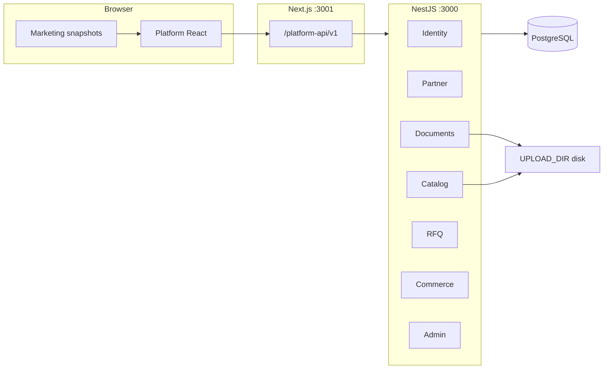

# GarudHub — UI/UX & Scalability Audit Report

**Date:** October 2026  
**Repository:** `garud` (Next.js frontend + NestJS backend)  
**Audience:** Product, design, and engineering stakeholders  
**Method:** Static codebase review of built platform routes, marketing bridge, and backend modules (no live QA pass).

---

## Executive summary

GarudHub ships a **two-surface** web app on one origin: **marketing HTML snapshots** (~47 routes) and a **React B2B platform** (24 routes) sharing `MarketingShell` chrome. Platform UX is **coherent and on-brand** for an MVP: shared tokens in `frontend/app/styles/platform.css`, reusable patterns (`PlatformPageHeader`, `EmptyState`, `RequireAuth`), and clear **RFQ vs checkout** split on listing detail.

**Strengths:** Marketing ↔ platform CTA bridging (`frontend/lib/snapshot-html.ts`, `frontend/middleware.ts`); marketplace section tabs with loading skeletons; partner hub with subnav; verification-gated catalog; single-vendor cart enforced in API and UI copy.

**Gaps for growth:** No Hindi/i18n; buyer post-login nav emphasizes **My RFQs** over orders/cart (`MarketingHeader.tsx`); legacy **PlatformShell** unused; inline styles on several pages; **localStorage** JWT; **no API rate limiting**; uploads on local disk; marketplace **no search/facets** at scale; **Phase 3 payments** stubbed (`PaymentStatus.PENDING` only); marketing enquiry still snapshot/PHP-shaped.

**Overall readiness:** Solid **Phase A–B** demo and early pilot; **P0** work needed before high-traffic multi-vendor commerce and compliance-heavy production.

---

## 1. Inventory

### 1.1 Platform routes (`frontend/app/(platform)/`)

| Route | Purpose | Primary persona |
|-------|---------|-----------------|
| `/auth/login` | Email/password sign-in, role-based redirect | All |
| `/auth/register` | Account + org onboarding (partner/buyer/gov types) | Partner, Buyer, Government |
| `/marketplace` | Tabbed catalog browse (products/services sections) | Public, Buyer |
| `/marketplace/listings/[id]` | Listing detail; add to cart or RFQ/enquiry CTAs | Public, Buyer |
| `/marketplace/partners/[orgId]` | Verified partner storefront summary | Public, Buyer |
| `/buyer/cart` | Single-vendor cart, qty updates | Buyer, Government |
| `/buyer/checkout` | Shipping/billing/GST PO; place order (no payment gateway) | Buyer, Government |
| `/buyer/orders` | Order history list | Buyer, Government |
| `/buyer/orders/[id]` | Order detail + fulfillment status | Buyer, Government |
| `/buyer/rfqs` | RFQ list | Buyer, Government |
| `/buyer/rfqs/new` | Create RFQ (optional listing prefill) | Buyer, Government |
| `/buyer/rfqs/[id]` | RFQ detail, invites, quotations | Buyer, Government |
| `/partner` | Dashboard, verification checklist, shortcuts | Partner |
| `/partner/application` | Company profile + submit for review | Partner |
| `/partner/documents` | GST/CIN etc. uploads | Partner |
| `/partner/catalog` | Listing list | Partner (verified for publish) |
| `/partner/catalog/new` | Create listing (pricing, images) | Partner |
| `/partner/catalog/[id]` | Edit listing | Partner |
| `/partner/orders` | Incoming buyer orders | Partner (verified) |
| `/partner/orders/[id]` | Fulfillment status updates | Partner (verified) |
| `/partner/rfqs` | RFQ invites inbox | Partner (verified) |
| `/partner/rfqs/[id]` | View RFQ + submit quotation | Partner (verified) |
| `/admin` | Application queue + status filter | Platform Admin |
| `/admin/applications/[id]` | Review application, approve/reject | Platform Admin |

**Layout:** All platform pages use `frontend/app/(platform)/layout.tsx` → `MarketingStyles` + `AuthProvider` + `MarketingShell` (not the unused `components/platform/PlatformShell.tsx`).

### 1.2 Marketing snapshot surface (two-track model)

Per `PROJECT_TWO_TRACKS.md` and `frontend/docs/SITE_AUDIT_AND_REBUILD_PLAN.md`:

| Track | Mechanism | Examples |
|-------|-----------|----------|
| **Snapshots** | `app/route.ts`, `app/[...slug]/route.ts`, `loadSnapshotHtml()` | `/`, `/about-us`, 9 service landings, partner landings, `/blogging/*`, `/legal.php/*`, `/enquiry.php`, calculators |
| **Platform React** | `(platform)` route group | `/marketplace`, `/auth/*`, `/partner/*`, `/buyer/*`, `/admin/*` |

**Bridging:** `localizeSnapshotHtml()` rewrites marketplace/partner CTAs to platform URLs; `middleware.ts` redirects `/drone-marketplace` → `/marketplace`, `/drone-accessories` → `?section=accessories`, rewrites blog/legal query URLs to filesystem snapshot paths.

**API proxy:** Browser calls `/platform-api/v1/*` → NestJS `:3000` (see `frontend/lib/api/client.ts`).

### 1.3 Backend modules (NestJS)

| Module | Path prefix (typical) | Responsibility |
|--------|----------------------|----------------|
| **Identity** | `/auth/*` | Register, login, refresh, logout, JWT, `RolesGuard` |
| **Partner** | `/partner/*` | Application profile, `GET /partner/me`, verification state |
| **Documents** | `/partner/documents/*` | Org document upload/download (`UPLOAD_DIR`) |
| **Catalog** | `/marketplace/*`, `/partner/catalog/*` | Public browse, partner CRUD, listing image upload + `/media/listings/*` |
| **RFQ** | `/rfq/*`, `/partner/rfqs/*` | Buyer RFQs, invites, quotations, matching |
| **Commerce** | `/buyer/cart/*`, `/buyer/checkout/*`, `/buyer/orders/*`, `/partner/orders/*` | Single-vendor cart, checkout, orders, fulfillment |
| **Admin** | `/admin/*` | Application review queue |
| **Prisma** | — | PostgreSQL ORM (`backend/prisma/schema.prisma`) |

---

## 2. UI/UX audit

Ratings: **Good** = ship-ready for pilot; **OK** = usable with known friction; **Needs work** = blocks scale or confuses users.

### 2.1 Marketing shell integration — **Good**

| Observation | Evidence |
|-------------|----------|
| Platform uses same header/footer as brand | `MarketingShell.tsx`, `MarketingHeader.tsx`, `MarketingFooter.tsx` |
| Skip link + `#main-content` | `MarketingShell.tsx` |
| Logged-in: email, dashboard link, cart (buyers), logout | `MarketingHeader.tsx`, `CartNavLink.tsx` |
| Auth links desktop-only until 1100px | `platform.css` `.header-auth-links` |

**Friction:** Snapshot pages lack React auth chrome unless user navigates to platform; visual jump between full-HTML marketing and React content is expected until Phase 1 rebuild.

### 2.2 Auth (login / register) — **Good**

| Observation | Evidence |
|-------------|----------|
| Shared auth layout, error banner, password field | `AuthCard.tsx`, `auth/login/page.tsx` |
| Labels, `aria-busy`, session gate | `login/page.tsx`, `register/page.tsx` |
| Role redirect after login | `login/page.tsx` `redirectPathForRole` |
| Register: account types, terms, strength hint | `register/page.tsx`, `labels.ts` |

**Needs work:** After register, redirect is `/marketplace` while login sends buyers to `/buyer/rfqs` — inconsistent “home dashboard” (`register/page.tsx` vs `AuthProvider.tsx` `homeForUser`).

### 2.3 Marketplace — **OK**

| Observation | Evidence |
|-------------|----------|
| Section tabs + URL `?section=` | `MarketplaceClient.tsx`, `marketplace-sections.ts` |
| Skeletons, `EmptyState`, min tab-switch delay | `MarketplaceClient.tsx`, `ListingCard.tsx` |
| Detail: price, MOQ, cart vs RFQ | `marketplace/listings/[id]/page.tsx` |
| External hero image on marketplace | `MARKETPLACE_HERO_IMAGE` in `MarketplaceClient.tsx` |

**Needs work:** No sitewide search, filters beyond tabs, or pagination UI; multi-category sections fetch client-side filter after `take*2` API call — won't scale; placeholder handling when images missing.

### 2.4 Buyer (cart, checkout, orders, RFQs) — **OK**

| Observation | Evidence |
|-------------|----------|
| `RequireAuth` on protected routes | e.g. `buyer/cart/page.tsx` |
| Checkout captures B2B fields (GST, PO) | `buyer/checkout/page.tsx` |
| RFQ flows with empty states | `buyer/rfqs/page.tsx`, `EmptyState.tsx` |
| Cart conflict message for multi-vendor | API `cart.service.ts`; UI hint on listing detail |

**Needs work:** Header dashboard for buyers is **My RFQs** only — no **Orders** link (`MarketingHeader.tsx` `dashboardLink`); loading states uneven on RFQ detail vs orders; inline styles on order pages.

### 2.5 Partner — **Good**

`PartnerPageShell` + `PartnerSubnav` on all partner routes; onboarding checklist (`partner/page.tsx`); `aria-live` on application save (`partner/application/page.tsx`); catalog upload + URLs (`ListingImageFields.tsx`); fulfillment (`PartnerOrderFulfillmentPanel.tsx`). **Needs work:** upload vs paste-URL confusion; gallery as raw URL text.

### 2.6 Admin — **OK**

Application queue + detail (`admin/page.tsx`, `admin/applications/[id]/page.tsx`). **Needs work:** no listing/user admin; filter label a11y on list page.

### 2.7 Cross-cutting

| Area | Rating | Notes |
|------|--------|-------|
| Typography / spacing | **Good** | Central tokens `platform.css`; `PlatformPageHeader` rhythm |
| Form patterns | **Good** | `.platform-field`, `.platform-form`, shared buttons |
| Empty / loading / error | **OK** | `EmptyState`, `PlatformLoading`, skeletons; not all routes use `aria-live` on errors |
| Mobile / responsive | **OK** | Marketing JS drawer; platform CSS breakpoints; tables use `.platform-table-wrap` |
| Accessibility | **OK** | Skip link, some `aria-busy`; sparse `aria-live` outside auth/application |
| i18n | **Needs work** | English-only UI; `en-IN` number/date formatting only (`labels.ts`) |
| Hindi / English copy | **Needs work** | No Hindi strings; marketing snapshots may contain mixed legacy copy |
| Known code pain points | — | Inline `style={{}}` on `MarketingHeader.tsx`, order/listing pages; unused `PlatformShell.tsx`; JWT in `lib/api/auth-storage.ts`; `resolveListingImageUrl` bridges `/api/v1` vs `/platform-api` paths |

---

## 3. Scalability & architecture (growth lens)

### 3.1 Frontend

| Topic | Assessment |
|-------|------------|
| Next.js structure | Clear split: snapshot routes vs `(platform)`; good long-term if marketing migrates to React |
| Bundle / caching | Platform routes client-heavy (`'use client'` on most pages); marketing assets static; snapshot `Cache-Control: max-age=0` |
| API client | Central `apiRequest` with refresh queue (`client.ts`) — solid pattern |
| Auth in localStorage | XSS-sensitive; no httpOnly cookies; tab sync via `storage` event only |

### 3.2 Backend

| Topic | Assessment |
|-------|------------|
| NestJS modularity | Clean module boundaries; guards composable (`JwtAuthGuard`, `RolesGuard`, `VerifiedPartnerGuard`) |
| Prisma / Postgres | Sensible indexes on listings, orders, RFQs; composite index on `[listingType, category, isPublished]` |
| N+1 | `browsePublic` single query with `include organization` — OK at moderate volume |
| File storage | `UPLOAD_DIR` local disk — blocks horizontal scale without shared object storage |
| Horizontal scale | Stateless API possible; uploads and refresh tokens need shared store strategy |

### 3.3 Multi-vendor commerce

| Topic | Assessment |
|-------|------------|
| Cart model | One cart per user, one `partnerOrganizationId` (`schema.prisma` `Cart`) |
| Order volume | Per-vendor order rows; indexes on `buyerUserId`, `vendorOrganizationId`, `placedAt` |
| Partner isolation | Verified gate on catalog/orders/RFQ partner endpoints; org-scoped queries |

### 3.4 Security

| Topic | Assessment |
|-------|------------|
| RBAC | Role enum on user + route guards |
| Verification gate | Unapproved partners blocked from listing publish and partner commerce APIs |
| PII on orders | Shipping/billing/GST stored on `Order` — needs retention policy and encryption-at-rest strategy |
| Rate limits | **Not observed** in codebase |
| Upload validation | Listing images: JPEG/PNG, 5MB (`listing-media.constants.ts`); org docs separate pipeline |

### 3.5 Ops & product scale

**Ops:** Prisma migrations + `seed.ts`; `docker-compose.yml` is Postgres-only; env (`DATABASE_URL`, `UPLOAD_DIR`, JWT) needs runbooks; **no** observability stack in repo.

**Product:** Four personas (Government ≈ buyer in UI); RFQ and checkout coexist without quote→order; payments stubbed (`PaymentStatus.PENDING`); enquiries stay on `/enquiry.php` snapshot; no notifications; marketplace browse capped at `take` ≤ 50, no full-text search.

---

## 4. Prioritized recommendations

### UI/UX

| Priority | Recommendation |
|----------|----------------|
| **P0** | Align post-auth destinations (register vs login vs header dashboard); add **Orders** + **Cart** to buyer header nav |
| **P0** | Unified error/empty patterns with `aria-live` on dynamic fetches (marketplace, cart, admin) |
| **P1** | Replace inline styles with utility classes in `platform.css`; remove or repurpose dead `PlatformShell.tsx` |
| **P1** | Marketplace: search box, pagination, server-side facet filters; listing image fallbacks |
| **P1** | Clarify listing images UX (upload-first, URL advanced) in `ListingImageFields.tsx` |
| **P2** | Hindi (or i18n framework) for platform strings; audit marketing snapshot copy |
| **P2** | Buyer mobile nav: expose cart without wide breakpoint |

### Technical scale

| Priority | Recommendation |
|----------|----------------|
| **P0** | Move auth tokens to httpOnly secure cookies + CSRF strategy; shorten access token TTL |
| **P0** | Object storage (S3/GCS) + CDN for `UPLOAD_DIR`; signed URLs for private docs |
| **P0** | Rate limiting on auth and upload endpoints |
| **P1** | Full-text search (Postgres `tsvector` or OpenSearch) on listings |
| **P1** | Multi-vendor cart or explicit “replace cart” UX with modal when adding cross-seller |
| **P1** | Observability: request IDs, health checks, error tracking (Sentry), audit log exports |
| **P2** | Payment gateway integration; webhooks; idempotent checkout |
| **P2** | Notification service (verification, RFQ invite, order status) |
| **P2** | Dockerize API + worker; migrate enquiry/leads to Nest |

---

## 5. References (key paths)

| Area | Path |
|------|------|
| Two-track architecture | `PROJECT_TWO_TRACKS.md` |
| Marketing inventory | `frontend/docs/SITE_AUDIT_AND_REBUILD_PLAN.md` |
| Platform styles | `frontend/app/styles/platform.css` |
| Shell / auth | `frontend/components/marketing/MarketingShell.tsx`, `frontend/components/platform/AuthProvider.tsx` |
| Commerce design notes | `docs/CHECKOUT_AND_PARTNER_CATALOG_DESIGN.md` |
| Schema | `backend/prisma/schema.prisma` |

---

*Report generated from repository state, October 2026. Recommend a follow-up moderated user test (buyer checkout + partner onboarding) before production marketing push.*
